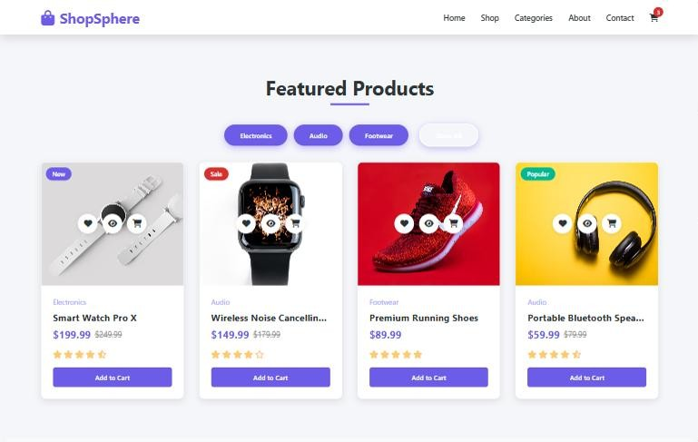

# ShopSphere — E-Commerce Homepage Design

A modern, responsive homepage for an online electronics and lifestyle store, built with plain HTML, CSS and JavaScript.

**Live demo:** https://mostafa-habib365.github.io/Ecommerce-tech-frontpage-design/




## Features

- Full-screen hero with clear calls to action
- Featured products with category filters, sale badges, ratings and quick actions
- Add-to-cart animation, with the cart count saved in the browser
- Shop-by-category tiles, a testimonial slider and a newsletter sign-up
- Sticky header and a mobile menu for small screens

## Built with

HTML · CSS · JavaScript · Font Awesome

## Run it locally

Open `index.html` in a browser, or serve the folder:

```bash
python3 -m http.server
```

---

Built by [Mostafa Habib](https://mostafa-habib.y98d7h5mkk.workers.dev/) — secure, fast websites for small businesses.
